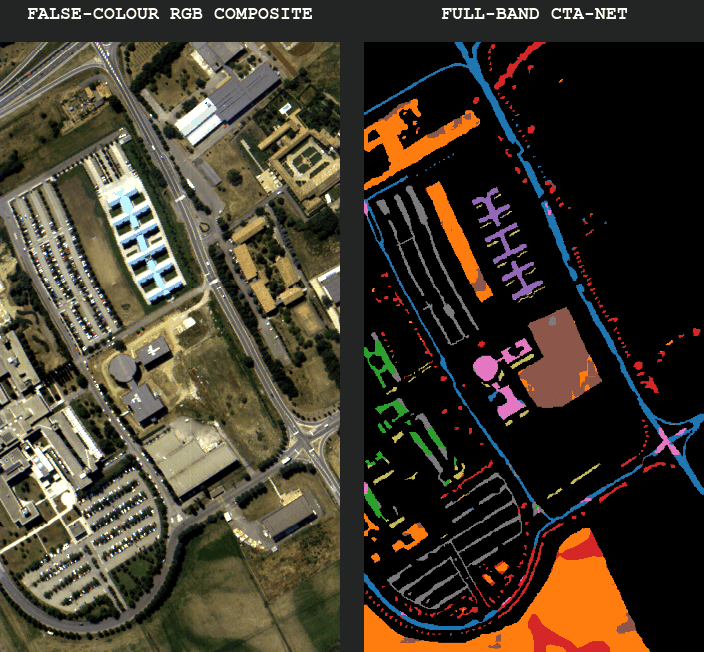

# Few-Samples Hyperspectral Image Classification and Adaptive Band Selection

<p align="center">
  
</p>

<p align="center">
  
  
  
  
  
</p>

**Given a 15 × 15 Pavia University hyperspectral patch, CTA-Net predicts the land-cover class at its center using only 10 training and 5 validation pixels per class. The learned band selector retains 72 of 103 bands; across five seeds on split 42, the compact model achieves 86.05 ± 1.29% test OA, 89.41 ± 0.92% test AA, and 82.05 ± 1.52% test Kappa.**

*Alessandro Carotenuto*

Reconstructed from:

> Chuan Fu, Tianyuan Zhou, Tan Guo, Qikui Zhu, Fulin Luo, and Bo Du, *CNN-Transformer and Channel-Spatial Attention based network for hyperspectral image classification with few samples*, Neural Networks 186 (2025), 107283. [DOI: 10.1016/j.neunet.2025.107283](https://doi.org/10.1016/j.neunet.2025.107283)

The paper proposes CTA-Net for few-sample hyperspectral image classification. This project implements its main components and documents choices that the paper leaves unspecified, including preprocessing, padding, attention details, and sample amplification parameters.

---

## Table of Contents

- [How it works](#how-it-works)
- [Final results](#final-results)
- [Ablation highlights](#ablation-highlights)
- [Architecture](#architecture)
- [Training pipeline](#training-pipeline)
- [Project structure](#project-structure)
- [Configuration](#configuration)
- [Usage](#usage)
- [Reproducibility and limitations](#reproducibility-and-limitations)
- [Reference](#reference)

---

## How it works

The model predicts the land-cover class of the center pixel in each hyperspectral patch.

```text
Input patch: 15 x 15 pixels, 103 spectral bands
                    |
             Input projection
                    |
          +---------+---------+
          |                   |
      CNN branch        Transformer branch
          |                   |
          +------ concatenate-+
                    |
               CT residual
                    |
          Channel-spatial attention
                    |
        Global average pooling + FC
                    |
             9 class scores
```

The main experiment follows the Pavia University few-shot setup: 10 training pixels and 5 validation pixels per class, with all remaining labeled pixels used for testing. Sample Amplification is applied to training patches only. Validation and test data are left unchanged.

## Final results

The final comparison evaluates the compact band-selected CTA-Net against a full-band CTA-CSA model trained from scratch. Both use the same fixed Pavia University split (`42`), five training seeds, and few-shot training data. The compact model trains its gate for 150 epochs, retains 72 of 103 bands (30% removed), and is fine-tuned for 30 epochs. The full-band baseline trains for 180 epochs. Metrics are mean ± sample standard deviation across seeds on the shared test set of 42,641 labeled pixels.

| Model | Bands retained | Test OA | Test AA | Test Kappa |
|---|---:|---:|---:|---:|
| Full-band CTA-CSA baseline | 103 / 103 | **88.47 ± 2.13%** | 89.72 ± 1.56% | **84.96 ± 2.66%** |
| Compact CTA-CSA with learned band selection | 72 / 103 | 86.05 ± 1.29% | **89.41 ± 0.92%** | 82.05 ± 1.52% |

Across paired seeds, compact-minus-full-band differences were `−2.42 ± 1.26` percentage points OA, `−0.31 ± 2.24` points AA, and `−2.92 ± 1.73` points Kappa. These results use one fixed random split; they do not establish generalization across independent spatial splits. The compact model reduces the spectral input, while measured CPU inference gains in the separate band-selection sweep were small.

### Earlier non-pruned ablations

These historical ablations are summarized as mean ± sample standard deviation over 10 training seeds on split `42`. They use `15 x 15` patches, 128 feature channels, 150 epochs, Adam at `0.00008`, and zero weight decay. They are separate from the final five-seed band-selection comparison above.

| Model | OA | AA | Kappa |
|-------|---:|---:|------:|
| CT + CSA, no sample amplification (4 heads) | 84.10 ± 4.06% | 88.03 ± 2.13% | 79.68 ± 4.77% |
| CTA-Net, with sample amplification (4 heads) | 85.55 ± 4.36% | 89.00 ± 2.17% | 81.48 ± 5.23% |
| CTA-Net, with sample amplification (8 heads) | **88.42 ± 2.67%** | **90.07 ± 1.28%** | **84.96 ± 3.21%** |

At 4 heads, sample amplification improves OA by `1.45` points and Kappa by `1.80` points. The 8-head configuration improves the observed OA by `2.87` points over the 4-head CTA-Net baseline. These are descriptive differences on one fixed split, not significance tests across independent data splits.

## Ablation highlights

The 8-head configuration is the strongest single-factor result for OA and Kappa in the recorded baseline ablations. Other changes did not improve all metrics at once:

| Configuration | Split | OA | AA | Kappa |
|---|---:|---:|---:|---:|
| 8 heads + Z-score input | 42 | 87.56 ± 2.79% | **90.68 ± 1.24%** | 83.97 ± 3.46% |
| Combined settings: 8 heads, 64 channels, patch 11, Z-score, LayerNorm, cosine schedule, and other changes | 42 | 85.09 ± 1.57% | 87.71 ± 1.23% | 80.73 ± 1.94% |
| Same combined settings | 1 | 78.51 ± 5.17% | 86.61 ± 2.12% | 73.12 ± 5.90% |

Combining individually tested settings did not outperform the 8-head baseline and produced different results across the two splits. These are earlier non-pruned runs. The full ablation tables and per-class results are in [ablations.md](ablations.md).

## Architecture

The classifier receives patches as `bands × height × width` tensors. A `1 × 1` input projection maps spectral bands to feature channels; the selected classifier then processes those spatial features.

| Configured variant | Components |
|---|---|
| `CNN_CSA` | Multiscale CNN, channel-spatial attention, and classifier |
| `CNN_TRANSFORMER` | Parallel CNN and Transformer branches, then classifier |
| `CNN_TRANSFORMER_CSA` | CNN-Transformer block, channel-spatial attention, and classifier; the complete CTA-Net classifier |
| `CNN_TRANSFORMER_CSA_BAND_PRUNING` | CTA-Net classifier with a learned adaptive spectral-band selection head |

The classifier variants reuse the same implementation blocks. Sample amplification is a training-data option applied outside the model; it is not a separate neural-network layer.

### CNN branch

Four parallel convolution branches capture spatial features at different receptive fields:

- one `1 x 1` convolution;
- one `3 x 3` convolution;
- two stacked `3 x 3` convolutions;
- three stacked `3 x 3` convolutions.

Branch outputs are concatenated and projected with a `1 x 1` convolution.

### Transformer branch

The Transformer branch follows a Conformer-style block with two feed-forward modules, multi-head self-attention with relative position information, and an internal convolution module. Attention operates over the spatial patch tokens. The CNN and Transformer branches process the same projected feature map in parallel. Their outputs are fused and added to the CT block input through an outer residual connection.

### Channel-spatial attention

The attention block applies channel attention followed by spatial attention. Spatial descriptors include the maximum, minimum, mean, and standard deviation across channels. Each attention stage has a residual connection.

### Adaptive spectral-band selection

The completed main experiment uses `CNN_TRANSFORMER_CSA_BAND_PRUNING` with a 30% bottom-k budget. A gated CTA-Net learns band scores from training samples; the selected binary mask retains 72 of the 103 bands. The compact model is fine-tuned for 30 epochs. For the paired comparison, a separate full-band CTA-CSA baseline is trained from scratch for 180 epochs with the same seed, split, and training data.

Gate scores are estimated from training samples only. STE starts after a 10-epoch soft-gate warm-up: the forward pass uses a binary mask and the backward pass uses soft gates for the approximate gradient. Validation selects checkpoints; test data does not choose bands or checkpoints.

A separate five-seed STE sweep used validation data, not the test set. Timing is single-thread CPU after filtering the normalized cube once:

| Bands removed | Bands kept | Compact validation OA after fine-tuning | Full → compact latency | Ratio |
|---:|---:|---:|---:|---:|
| 70% | 31 | 82.7 ± 3.3% | 2.362 → 2.530 ms/sample | 0.93× |
| 80% | 21 | 83.6 ± 2.0% | 2.210 → 2.126 ms/sample | 1.04× |
| 90% | 10 | 78.7 ± 6.6% | 2.192 → 2.119 ms/sample | 1.03× |

These timing gains are small and do not establish a robust speedup. A separate one-seed 99% pruning run retained one band and reached 46.7% validation OA after fine-tuning. Detailed protocols are in [ablations.md](ablations.md).

### Sample amplification

The `CTA_NET` mode materializes four training pools for every run: original patches, Gaussian-noise variants outside a protected central `3 x 3` region, randomly rotated patches, and same-class direct-sum patches. With 10 original patches per class, this implementation produces 39 patches per class, 351 total. The augmentation seed is tied to the run's training seed for reproducibility.

## Training pipeline

1. Load `PaviaU.mat` and `PaviaU_gt.mat`; create the fixed random split (seed 42, 10 train and 5 validation pixels per class).
2. Apply per-band min-max normalization, reflect padding, and extract `15 x 15` patches. CTA-Net sample amplification is applied to training patches only.
3. Train the gated model for 150 epochs. STE is enabled after its 10-epoch warm-up; validation selects the checkpoint and the training loader determines the global bottom-k mask.
4. Build the compact model from the retained bands and fine-tune it for 30 epochs. Train a full-band CTA-CSA comparison model from scratch for 180 epochs per seed.
5. Evaluate the compact and full-band models on the same test split. The notebook prints aggregate and paired metrics, plots their confusion matrices, and builds classification maps for the seed with the lowest compact-model validation loss.
6. Save checkpoints under `outputs/checkpoints/` and evaluation/comparison reports under `outputs/results/`.

## Project structure

```text
.
├── data.py                              # Splits, normalization, patch datasets, SA
├── evaluation.py                        # Metrics, reports, classification maps
├── models.py                            # CNN, Transformer, CSA architectures
├── plotting.py                          # Result and training visualizations
├── training.py                          # Training loop, seeds, checkpoints
├── utils.py                             # Enumerations and shared configuration types
├── ablations.md                          # Detailed accuracy, pruning, and timing results
├── NOTEBOOK.ipynb                        # Main experiment and analysis notebook
├── readme_assets/
│   └── hyperspectral-full-scene.gif      # Full-scene animated input/result comparison
├── docs/
│   └── research/                         # Method and replication notes
└── tests/                                # Focused data and configuration tests
```

The Pavia University `.mat` files are not included. Place `PaviaU.mat` and `PaviaU_gt.mat` in `data/raw/` for local runs, or attach them as notebook inputs in Kaggle.

## Configuration

The notebook's current defaults are:

| Setting | Value |
|----------|-------|
| `ARCHITECTURE` | `CNN_TRANSFORMER_CSA_BAND_PRUNING` |
| `SPLIT_SEED` / `DATA_SPLIT_TYPE` | `42` / `RANDOM` |
| Train / validation samples per class | `10` / `5` |
| `PATCH_SIZE` / `INPUT_NORMALIZATION` | `15` / `MIN_MAX` |
| `FEATURE_CHANNELS` / `TRANSFORMER_HEADS` | `128` / `8` |
| Transformer FFN expansion / residual scale | `4` / `0.5` |
| Position encoding / CNN normalization | `LEARNED_2D` / `BATCH_NORM` |
| `SAMPLE_AMPLIFICATION_MODE` | `CTA_NET` (central region `3`, noise std `0.04`) |
| `EPOCHS` / compact fine-tuning | `150` / `30` |
| Optimizer / learning rate / weight decay | Adam / `0.00008` / `0.0` |
| `LR_SCHEDULING` | `FIXED` |
| `PRUNING_PERCENTAGE` | `30.0` (31 of 103 bands removed; 72 retained) |
| Pruning gate slope / sparsity weight | `20.0` / `0.001` |
| `TRAINING_SEED_MODE` / `NUM_SEEDS` | `MULTI_FIXED_TRAIN_SEED` / `5` |
| Active training seeds | `1496815513`, `1940408339`, `194592138`, `628378136`, `109688099` |
| `BATCH_SIZE` / `NUM_WORKERS` | `32` / `0` |
| `DEVICE` | CUDA when available, otherwise CPU |

The five active seeds define the completed main experiment. The other five seeds are retained in the notebook for extending the run. The sample-amplification settings are described in [the sample amplification note](docs/research/cta_sample_amplification.md); Transformer reconstruction choices are in [the Conformer analysis](docs/research/hsi_conformer_architectures.md).

## Usage

Keep `NOTEBOOK.ipynb` and the six imported modules (`data.py`, `evaluation.py`, `models.py`, `plotting.py`, `training.py`, `utils.py`) in the same project folder and run the notebook from that folder. Locally, put `PaviaU.mat` and `PaviaU_gt.mat` in `data/raw/`. On Kaggle, attach the Pavia University dataset; the notebook finds both files under `/kaggle/input` and loads the project modules from the repository.

Run the notebook cells in order. It writes model and compact-model checkpoints under `outputs/checkpoints/`, and test and paired-comparison reports under `outputs/results/`. Required packages are PyTorch, NumPy, SciPy, scikit-learn, and Matplotlib.

## Reproducibility and limitations

- The notebook is configured for one fixed few-shot split and five training seeds. Historical non-pruned ablations use ten seeds on split 42. Neither is a study across independent data splits.
- The paper does not specify every Transformer, preprocessing, or sample amplification parameter. Those implementation choices are recorded in the research notes and run reports.
- Per-band min-max normalization uses the full image cube. It does not use labels, but it uses feature statistics from the complete scene.
- Random pixel splits allow neighboring patches to overlap spatially. Spatially separated splits are available as a separate robustness experiment.
- The final comparison covers five training seeds on one fixed random split; neighboring patch overlap and full-scene feature normalization limit how broadly the test results should be generalized.
- The compact model trades some overall accuracy for a smaller spectral input. The measured inference speedup is modest and does not establish a robust latency advantage.

## Reference

```bibtex
@article{fu2025ctanet,
  title   = {CNN-Transformer and Channel-Spatial Attention based network for hyperspectral image classification with few samples},
  author  = {Fu, Chuan and Zhou, Tianyuan and Guo, Tan and Zhu, Qikui and Luo, Fulin and Du, Bo},
  journal = {Neural Networks},
  volume  = {186},
  pages   = {107283},
  year    = {2025},
  doi     = {10.1016/j.neunet.2025.107283}
}
```
